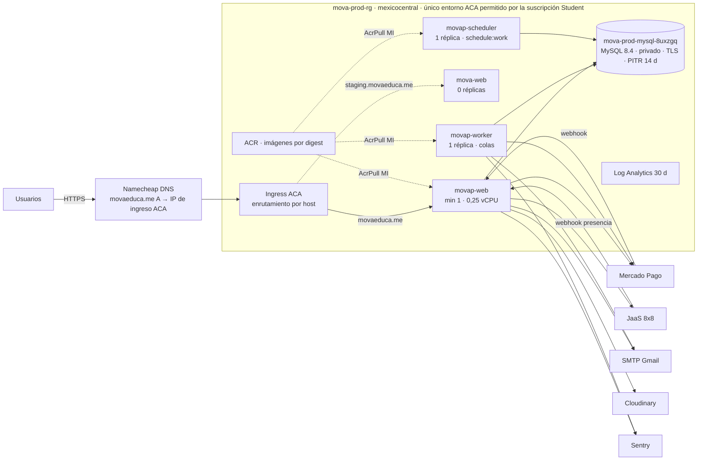
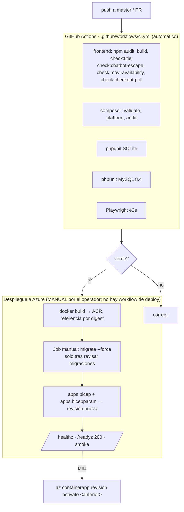

# 01 · Despliegue, CI/CD y operación

> Fuente de estado: [Ledger](../release/MOVA_V1_COMPLETION_LEDGER.md) y
> [Runbook de producción](../release/MOVA_PRODUCTION_RUNBOOK.md). IaC: [`infra/azure`](../../infra/azure/README.md).

## Hechos verificados (2026-10-19)

| Tema | Estado real | Evidencia |
|---|---|---|
| Producción | **Azure Container Apps** sirve `https://movaeduca.me` (apex; `www` → apex 301). Apps `movap-web`, `movap-worker`, `movap-scheduler` (worker/scheduler min=max=1; web min 0 hoy, diseño original min 1) | Ledger «Estado actual» (2026-10-06/07), `PRODUCTION_LIVE` |
| Base de datos | MySQL 8.4 Flexible Server **dedicado** `mova-prod-mysql-8uxzgq` (B1ms, privado, TLS, PITR 14 días, sin HA ni geo-redundancia) | Runbook §1, §3 |
| Staging | Apps `mova-*` a **0 réplicas** y **sin base de datos** (eliminada el 2026-10-06 para ahorrar crédito; recreable, ver Runbook §1b) | Runbook §1b |
| Railway | **LEGACY, no operable**: todos los deployments `FAILED` desde julio de 2026; ya no es producción ni rollback | Ledger «Railway (LEGACY)» |
| Escala (2026-10-19) | Se halló `movap-worker`/`movap-scheduler` en `minReplicas=0` (colas y tareas detenidas); **restaurados a min=max=1 el mismo día**, verificados en logs. `movap-web` sigue en min 0 (frío en reposo) | `az containerapp show`, logs; Runbook §1c |
| Liquidación | `LESSON_SETTLEMENT_MODE=live` en producción desde 2026-10-06: solo mueve el **ledger interno de créditos** (consume reservas a los 7 días), **no mueve dinero real**. Revertible a `dry_run` | Ledger «Estado de lanzamiento controlado» |
| Pagos live | Mercado Pago live cargado; checkout abierto **solo** a la cuenta de prueba del propietario (`MERCADOPAGO_CHECKOUT_ALLOWLIST`). Único intento (Yape S/ 1) rechazado con HTTP 400 / 2072; sin cobro | [Incidente](../release/INCIDENT_2026-10-06_yape_live_checkout.md) |
| Imagen vigente | `mova@sha256:237d93c8…` (`release-20261007-99d873c`) | Ledger «Despliegue vigente» |
| Crédito Azure | US$ 86 de 100, vence 2027-09-14 (≈ US$ 7,6/mes sostenible) | Ledger / Runbook §1 |

> El texto «Azure staging con `dry_run`» de `infra/azure/README.md` es una
> lectura del **2026-09-29** y describe staging; ya no describe producción.

## Topología

Restricciones reales: un solo entorno ACA por suscripción ⇒ producción y
staging comparten entorno, VNet, ACR y logs (una caída del entorno afecta a
ambos). El scheduler es **único** (min=max=1): dos `schedule:work` duplicarían
recordatorios y reconciliaciones.

## Pipeline

- **No existe `deploy-azure.yml`.** El despliegue es manual y reproducible
  (Runbook §2). Automatizarlo con OIDC es deuda (ver [05](05-claims-verification.md)).
- **Las migraciones no corren al arrancar**; `/readyz` devuelve 503 con
  migraciones pendientes, por lo que una revisión nueva no se activa y la
  anterior sigue sirviendo.
- **Rollback real:** `az containerapp revision list` + `revision activate` con el
  digest previo guardado en ACR. Las migraciones recientes son aditivas; ver el
  *STOP* de `student_data_consents` en `infra/azure/README.md` (no revertir esa
  migración con datos reales).
- Un secreto guardado no basta: Container Apps exige una revisión nueva, y cada
  rol (web/worker/scheduler) necesita la variable que lo referencia.

## Recuperación

| Elemento | Valor | Estado |
|---|---|---|
| RPO | PITR: hasta 14 días hacia atrás, granularidad de minutos | configurado |
| RTO | ≈ 50 min medidos en prueba real (2026-10-05, 32 GB en B1ms) | **probado** |
| Sin HA / sin geo-backup | Decisión de costo (crédito limitado) | riesgo aceptado |
| Datos sensibles al restaurar | Servidores de prueba contienen datos personales: eliminar al terminar | procedimiento en Runbook §3 |
