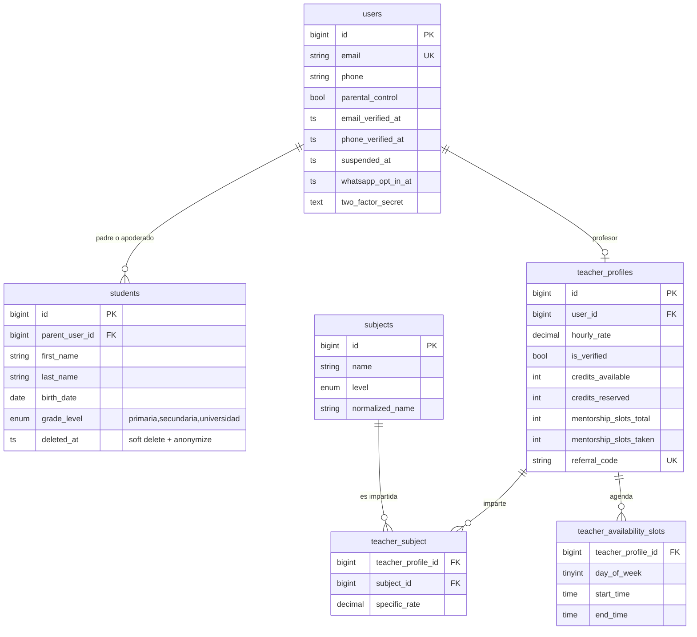
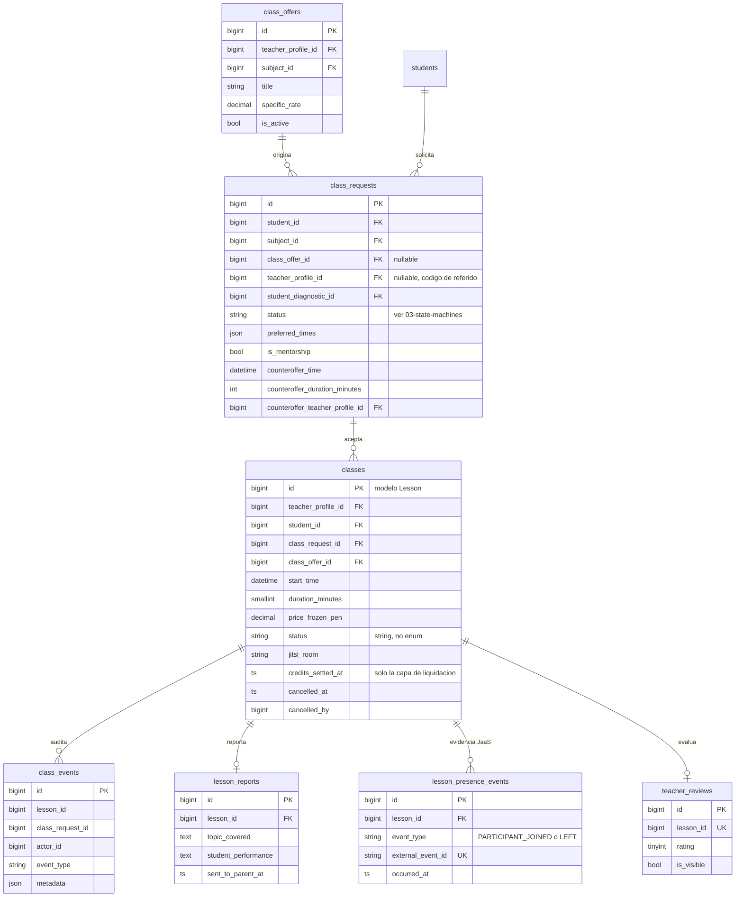
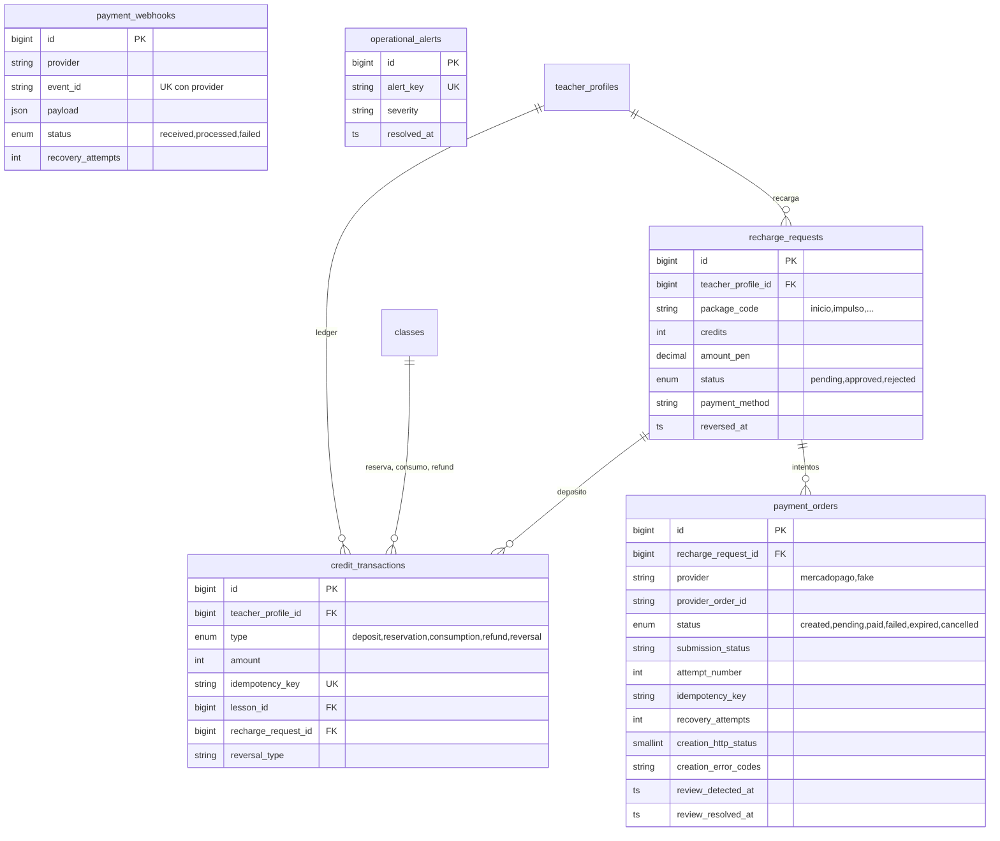
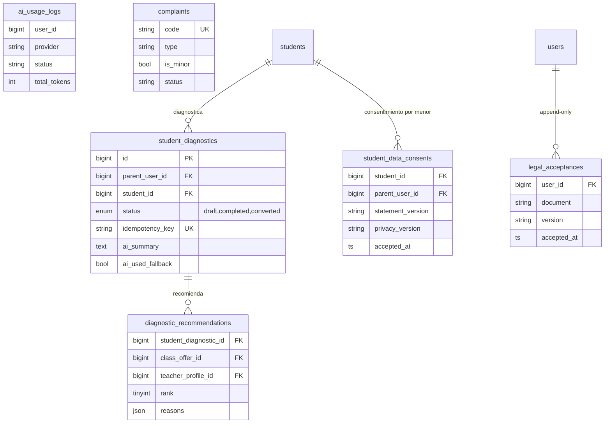

# 02 · Modelo de datos

> Derivado de las 103 migraciones de `database/migrations` y de `app/Models`
> (2026-10-19). Se omiten columnas de auditoría menores; `created_at/updated_at`
> existen salvo indicación. Tablas del framework (`cache`, `jobs`, `sessions`,
> `notifications`, `personal_access_tokens`…) no se dibujan.
> **Ojo:** el modelo `Lesson` usa la tabla `classes`; el padre es un `users`
> (con rol) y el alumno (`students`) **no tiene cuenta**.

## Identidad y catálogo

Roles (Spatie): `admin`, `teacher`, `parent`. El admin exige MFA TOTP server-side.

## Solicitudes y clases

La presencia JaaS es **solo evidencia**: no decide asistencia ni toca créditos.

## Créditos y pagos (ledger append-only)

Invariantes (CODE): el UNIQUE sobre `credit_transactions.idempotency_key` impide
doble reserva/consumo/depósito; `credits_settled_at` es solo caché derivada;
cada mutación se hace en transacción con `lockForUpdate()` (profesor y alumno).
`mova:reconcile-ledger` compara saldos y ledger a diario (03:10). **Los montos del
ledger son créditos enteros** (1 crédito = 60 min; paquete «Inicio» = 5 créditos por S/ 10).

## Diagnóstico, IA, consentimientos y soporte

`student_data_consents` es evidencia legal por menor: **no se infiere** para
alumnos históricos y su `down()` no debe ejecutarse con datos reales.
Las tablas de WhatsApp (`whatsapp_messages`, `whatsapp_webhook_events`) existen,
pero el canal está apagado en producción.
