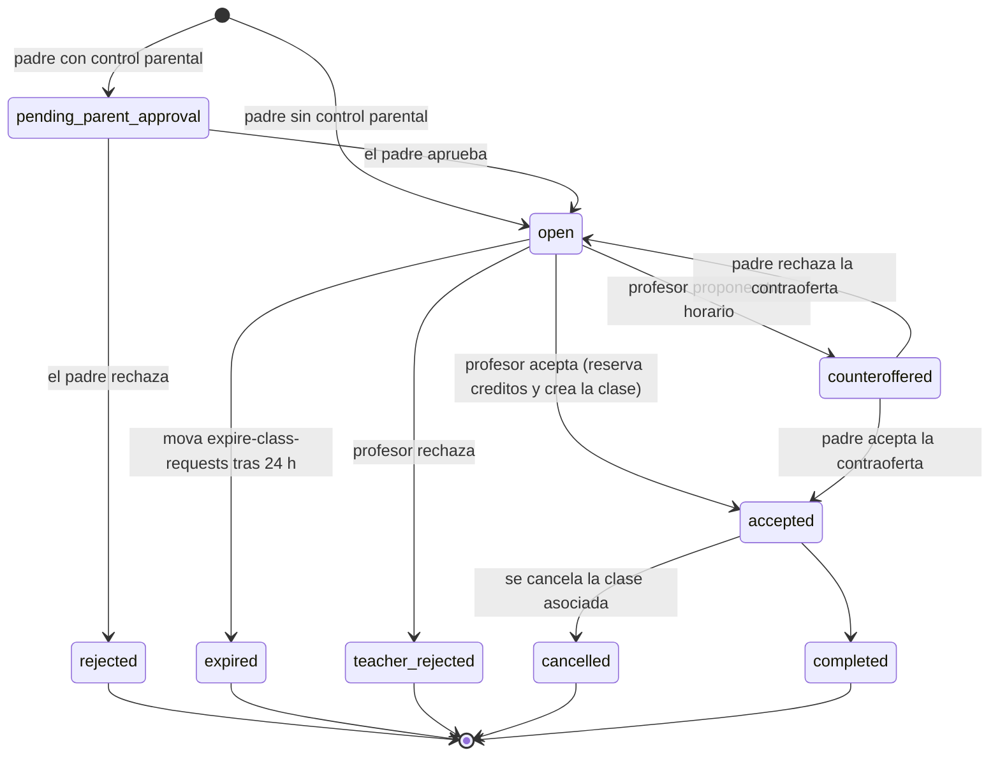
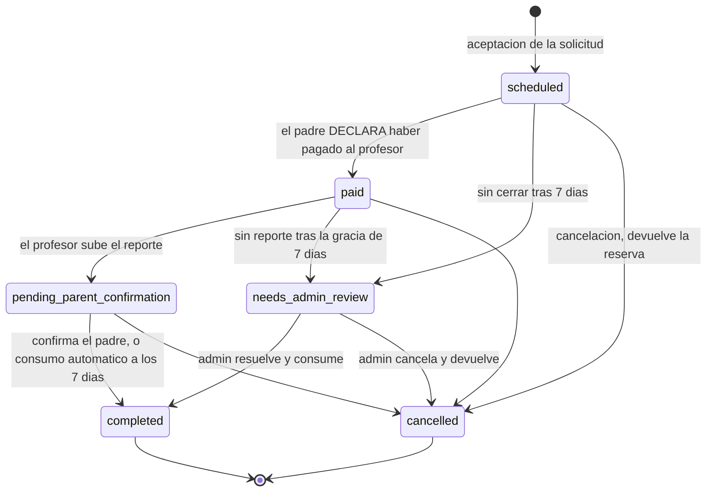
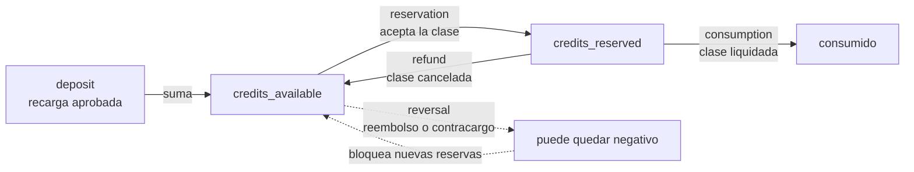
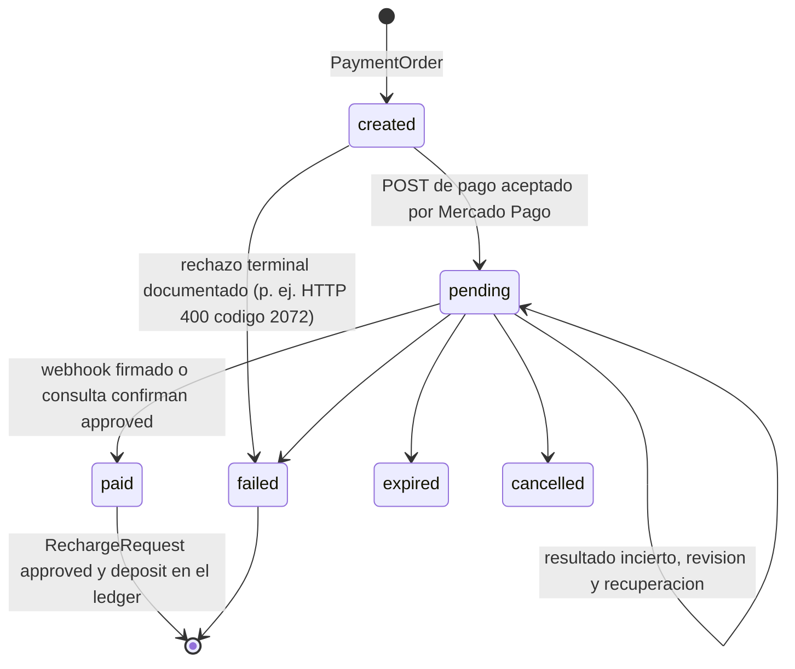

# 03 · Máquinas de estado

> Verificado en `ClassRequestController`, `CounterofferController`,
> `LessonSchedulingService`, `LessonController`, `LessonReportController`,
> `LessonSettlementService`, `SettleLessons` y `ExpireClassRequests` (2026-10-19).

## `class_requests.status`

Valores: `pending_parent_approval`, `open`, `accepted`, `rejected`, `completed`,
`teacher_rejected`, `counteroffered`, `expired`, `cancelled`.

- Sí existe `cancelled` (la auditoría externa decía que no). `expired` no
  revierte créditos porque aún no hubo reserva.
- La expiración (`config/class_requests.php`, 24 h por defecto) toma lock y no
  expira si ya hay una clase viva colgando de la solicitud.
- Visibilidad al profesor (`scopeVisibleToTeacher`): con `teacher_profile_id`
  (código de referido) solo ese profesor; con `class_offer_id` el dueño de la
  oferta; sin ambos, todos los verificados de la materia.

## `classes.status` (modelo `Lesson`)

Valores reales: `scheduled`, `paid`, `pending_parent_confirmation`,
`needs_admin_review`, `completed`, `cancelled`. **No existe `pending`**: el estado
inicial es `scheduled`.

- **`paid` no significa pago verificado**: es una declaración unilateral del
  padre (el pago padre→profesor ocurre fuera de MOVA, por Yape/Plin). Aun así
  habilita el reporte y arranca el reloj de liquidación. Es una asimetría
  aceptada y documentada en el docblock de `Lesson.php` (F-11); separarla en dos
  estados sería una migración de riesgo alto (30+ ubicaciones).
- **Consumo** (`consumption`): desde `paid`, `pending_parent_confirmation` o
  `needs_admin_review`. **Devolución** (`refund`): desde `scheduled`, `paid`,
  `pending_parent_confirmation` o `needs_admin_review`.
- Los créditos no quedan bloqueados indefinidamente: una clase que no se cierra
  escala a `needs_admin_review` a los 7 días (`credits.settlement_grace_days` /
  `credits.unconfirmed_days`), donde un admin decide consumir o devolver.

## Créditos del profesor

El saldo disponible negativo (reverso con créditos ya gastados) **bloquea
automáticamente nuevas reservas** (`credits_available < creditsNeeded`) sin tocar
el ledger. Prueba: `MonetizationIntegrityTest::test_negative_credit_balance_blocks_new_reservations_automatically`.

## `recharge_requests.status` y `payment_orders.status`

`recharge_requests.status`: `pending → approved | rejected`; una recarga aprobada
puede revertirse (`reversed_at`, `reversal_state`) generando una fila `reversal`.

Regla: un resultado **incierto nunca se convierte en éxito ni en rechazo** sin
evidencia (búsqueda por `external_reference`, webhook firmado). El cierre
administrativo `close-rejected-payment` exige evidencia persistida del rechazo,
ledger vacío, ≥ 10 min y búsqueda remota con 0 pagos.
