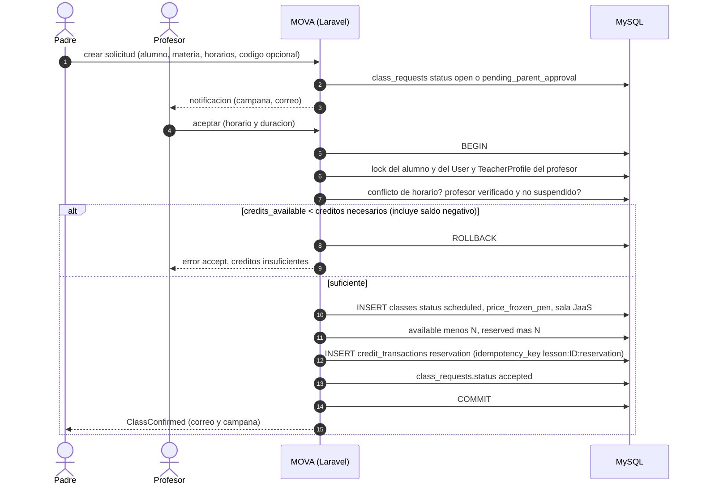
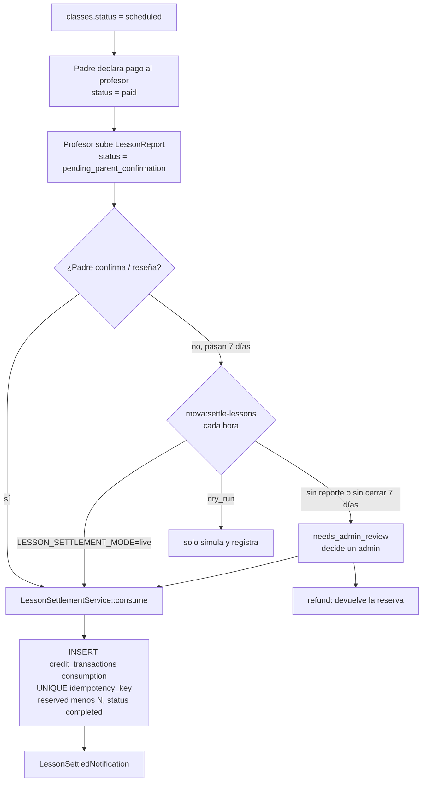
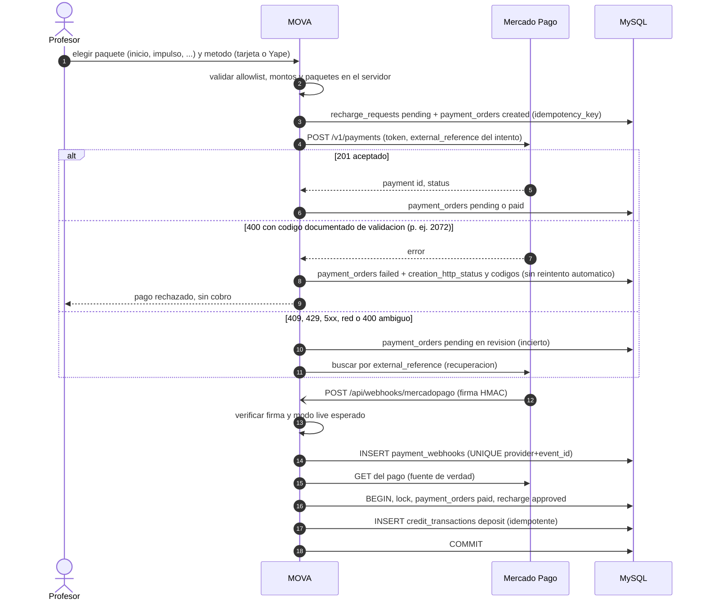
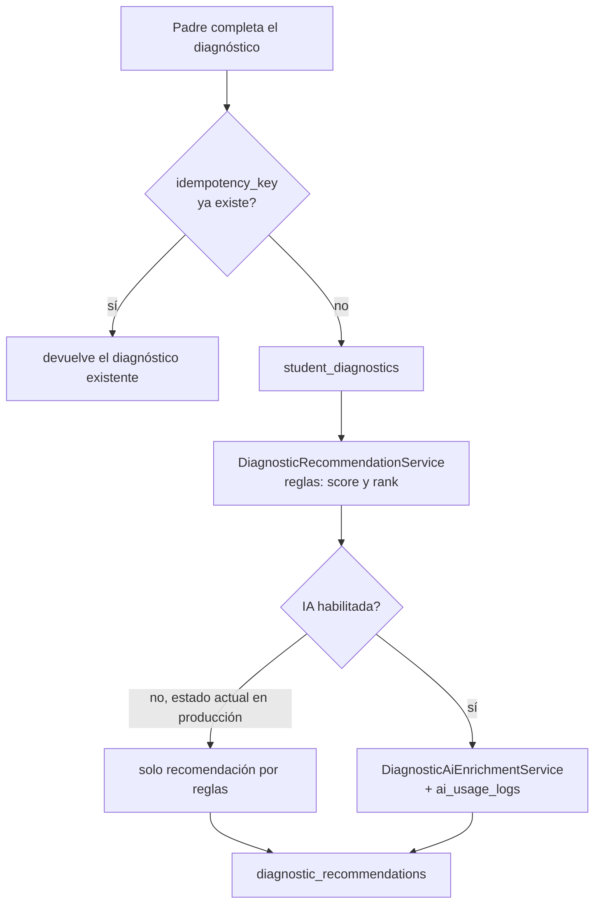

# 04 · Flujos principales

> Evidencia: `LessonSchedulingService`, `LessonSettlementService`,
> `MercadoPagoPaymentProvider`, `MercadoPagoPaymentReconciliationService`,
> `PaymentWebhookService`, `app/Console/Kernel.php`. Dinero real en MOVA = **solo
> la recarga de créditos del profesor** (Mercado Pago). El pago padre→profesor por
> la clase **no existe en MOVA**: ocurre fuera (Yape/Plin) y el padre solo lo declara.

## 1. Solicitud, aceptación y reserva de créditos

## 2. Ejecución, reporte y liquidación de créditos

La liquidación es **solo ledger interno de créditos**; en producción corre en
`live` desde 2026-10-06 y es reversible a `dry_run`.

## 3. Recarga de créditos con Mercado Pago

- `mercadopago:reconcile` corre cada 5 min y reprocesa webhooks fallidos sin
  duplicar abonos. Un reembolso/contracargo confirmado genera un `reversal`.
- El webhook usa un throttle propio de 120/min y evita el `throttle:api` global de 60/min (`routes/api.php`), para no descartar reintentos legítimos.
- Estado real del checkout live: abierto solo a la cuenta de prueba del
  propietario; el único intento live fue rechazado con **2072** y sigue sin
  causa raíz (caso en [MERCADOPAGO_SUPPORT_CASE_2072](../release/MERCADOPAGO_SUPPORT_CASE_2072.md),
  sin enviar). No se reintenta ni se cambia el importe por conjetura.
- **Culqi no existe**: `CulqiPaymentProvider` lanza `RuntimeException` en todos
  los métodos; aunque `supported_providers` lo lista, el arranque con
  `PAYMENT_PROVIDER=culqi` no funciona (ver [05](05-claims-verification.md)).

## 4. Tareas programadas (scheduler único)

| Comando | Frecuencia | Función |
|---|---|---|
| `classmate:send-reminders` | cada minuto | recordatorios de clase y solicitud |
| `mova:settle-lessons` | cada hora | consumo automático / escalado (`--dry-run` si no es `live`) |
| `mova:expire-class-requests` | cada hora, minuto 30 | expira solicitudes `open` tras 24 h |
| `mercadopago:reconcile` | cada 5 min | reconcilia pagos y webhooks (si los pagos están activos) |
| `mova:health-check --alert` | cada hora | alertas operativas (`operational_alerts`) |
| `mova:reconcile-ledger --alert` | diaria 03:10 | compara saldos y ledger |
| heartbeat | cada minuto | `system_heartbeats` para `/readyz` y el Operations Center |

## 5. Diagnóstico e IA

La IA externa está **apagada** en producción; Movi usa `CHATBOT_PROVIDER=local`.
La política de privacidad declara que no se envían datos a IA
(`LEGAL_PRIVACY_AI_MISMATCH` lo vigila). Antes de activar IA con datos de
menores hace falta el texto de consentimiento específico y confirmar la
redacción previa de datos personales.
