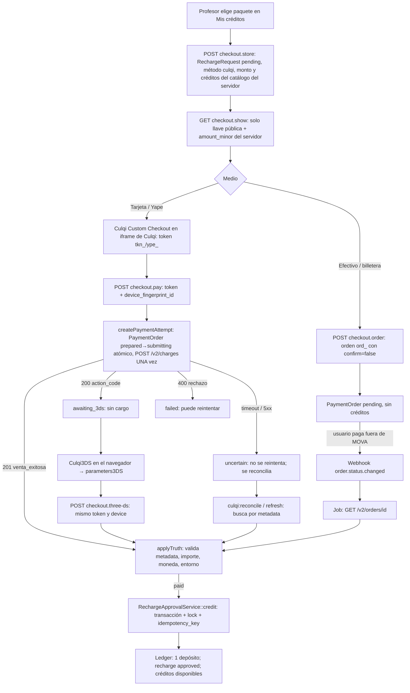
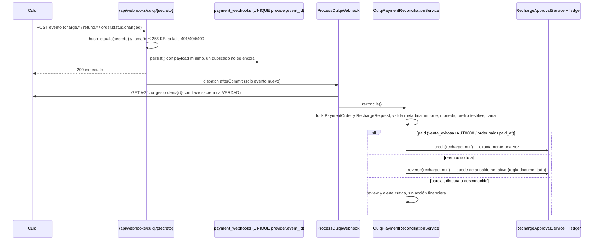
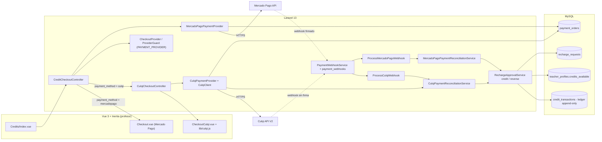
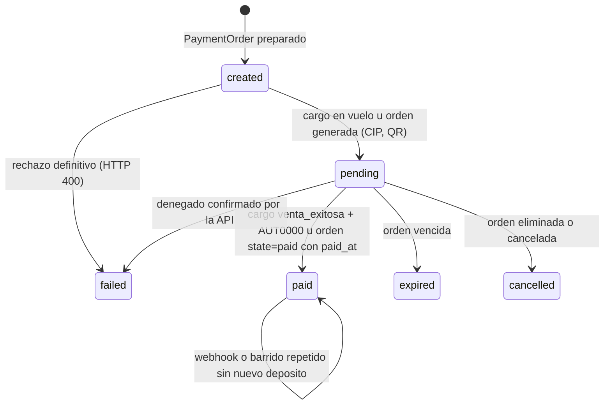
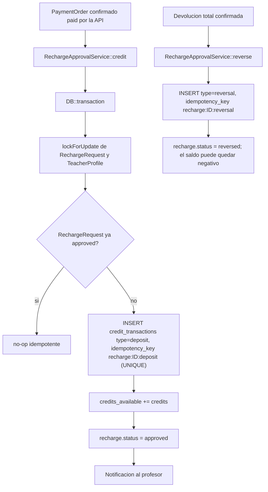
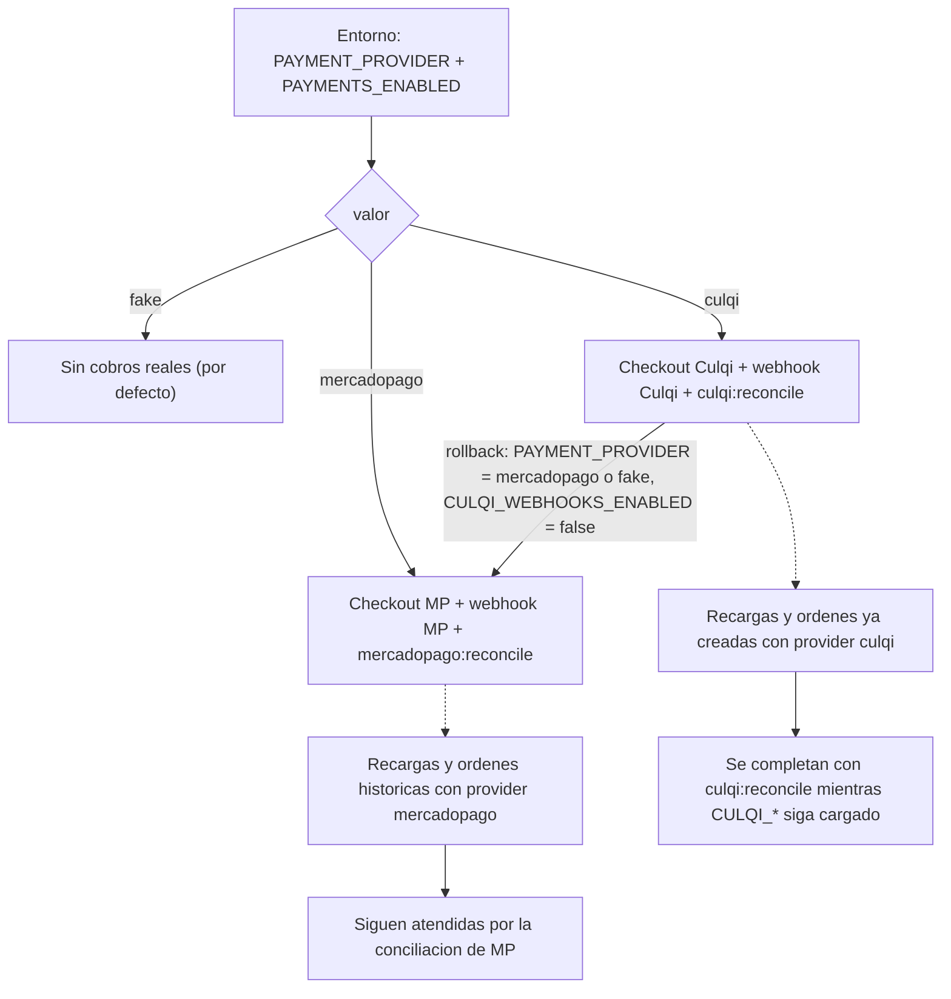

# Pagos de MOVA: de Mercado Pago a Culqi — arquitectura, flujo de créditos, manual operativo y migración

> Estado: CURRENT · 2026-10-22. Describe lo **implementado y comprobado** (ver §8 para el nivel de evidencia de cada afirmación).
> Detalle técnico de Culqi, evidencia de sandbox y pasos manuales: [`payments-culqi.md`](payments-culqi.md).
> Comportamiento y estados del dinero: el código manda; si algo aquí lo contradice, este documento está desactualizado.

## 1. Por qué MOVA usa Mercado Pago hoy (solo evidencia del repositorio)

| Fecha | Commit | Hecho |
|---|---|---|
| 2026-08-26 | `610b32b` | Se añade la capa de pagos con **Culqi como proveedor previsto**: `CulqiPaymentProvider` es un *stub deliberado* porque «MOVA todavía no tiene cuenta comercial». Aquí nace `RechargeApprovalService`. |
| 2026-09-02 | `799320b`, `b72a437` | Se implementa Mercado Pago Payments API (tarjeta, Yape, webhooks, conciliación) «reemplazando el intento anterior de Orders API». |
| 2026-09-03/04 | `9f00b6d`, `603778b`, `662fed3` | Card Brick, 3DS de Mercado Pago y compensación de retos perdidos. |
| 2026-10-06 | `docs/release/INCIDENT_2026-10-06_yape_live_checkout.md` | Primer cobro live (Yape S/ 1) rechazado por Mercado Pago (HTTP 400, código 2072); caso WCS-55456 en soporte. |
| 2026-10-19 | `17765bf` | Culqi se retira de `supported_providers` por seguir siendo stub (fail-closed). |

**No existe una decisión de negocio documentada** (ni en commits ni en `MOVA_V1_DECISIONS.md` ni en el Ledger) que explique *por qué* se eligió Mercado Pago frente a Culqi. La única razón con evidencia es indirecta: Culqi estaba bloqueado por no tener cuenta comercial. No se infiere nada más.

## 2. Cómo funciona cada pasarela

| Aspecto | Mercado Pago (conservado) | Culqi (nuevo) |
|---|---|---|
| Selección | `PAYMENT_PROVIDER=mercadopago` | `PAYMENT_PROVIDER=culqi` (uno solo activo) |
| Navegador | `MercadoPago.js`, Card Brick, Yape | `CulqiCheckout` (Custom) y `Culqi3DS` v1 — solo llave pública |
| Pantalla | `Teacher/Credits/Checkout.vue` | `Teacher/Credits/CheckoutCulqi.vue` |
| Controlador | `CreditCheckoutController` | `CulqiCheckoutController` (el de MP delega a él si `payment_method=culqi`) |
| Cobro | `POST /v1/payments` con `X-Idempotency-Key` | `POST /v2/charges` **sin** cabecera de idempotencia → protección propia (§4) |
| 3DS | iframe con `creq` | `Culqi3DS`: 1.er cargo → 200+`action_code` → reto → 2.º cargo con `authentication_3DS` |
| Efectivo/billeteras | no | Órdenes `POST /v2/orders` (PagoEfectivo, billeteras, banca móvil, agentes) |
| Webhook | `/api/webhooks/mercadopago` firmado (HMAC) | `/api/webhooks/culqi/{secreto}` — Culqi **no firma** |
| Conciliación | `MercadoPagoPaymentReconciliationService` | `CulqiPaymentReconciliationService` |
| Tablas | `payment_orders`, `payment_webhooks`, `recharge_requests`, `credit_transactions` (compartidas; `provider` distingue) | las mismas, `provider='culqi'` |
| Núcleo financiero | `RechargeApprovalService::credit()/reverse()` | el mismo |

Convivencia: cada `RechargeRequest` conserva su `payment_method` (`mercadopago` | `culqi`) y cada `PaymentOrder` su `provider`. Cambiar `PAYMENT_PROVIDER` **no** migra ni reinterpreta pagos ya creados; los de Mercado Pago siguen atendiéndose por su controlador, webhook y conciliación mientras exista código/credenciales de MP.

### Dependencias de Mercado Pago que siguen vivas (no se borran)
`CreditCheckoutController` (+`Checkout.vue`, `lib/mercadoPago*.js`), `MercadoPagoPaymentProvider`, `MercadoPagoPaymentReconciliationService`, `MercadoPagoWebhookRecoveryService`, `ProcessMercadoPagoWebhook`, `MercadoPagoWebhookController`, `PaymentReviewResolutionService` (cierre de rechazos MP), `mercadopago:*` (comandos y barrido agendado), `HealthCheck`, `ProviderGuard`/`AppServiceProvider` (rama `mercadopago`), 26 archivos de tests y la skill `mova-mercadopago`.

## 3. Recorrido del pago (Culqi)

## 4. Garantías contra el doble cobro y el doble crédito

1. **Un intento = una fila** `payment_orders` creada *antes* de hablar con Culqi, con `idempotency_key` propio que viaja en `metadata`.
2. **Reclamo atómico** `UPDATE … WHERE submission_status='prepared'`: de dos peticiones simultáneas (doble clic) solo una envía.
3. **El POST nunca se reintenta.** Un resultado incierto deja `uncertain` y bloquea cobros nuevos hasta reconciliar; el barrido busca el cargo por `metadata`/importe/ventana (`culqi:reconcile`). Una orden en vuelo reciente (< 2 min) no consume el presupuesto de búsquedas.
4. **3DS**: el segundo POST exige el mismo token y device (comparados por SHA-256) y ventana vigente; un 3DS que vuelve a pedir autenticación termina (sin bucles).
5. **Crédito exactamente-una-vez**: `credit()` bajo transacción con `lockForUpdate` + `credit_transactions.idempotency_key='recharge:{id}:deposit'` único. Probado con 5 repeticiones, 3 eventos distintos del mismo pago, webhook repetido, reentrada concurrente y worker caído a mitad (la transacción revierte y el reintento acredita una vez). Pruebas de concurrencia reales entre procesos: ver §8.
6. **La verdad es la API**, no el webhook ni el navegador: monto, créditos y estado financiero los decide el servidor; el cliente solo envía el token.

## 5. Flujo de créditos (contrato de negocio real, verificado en el código)

- **Qué es un crédito:** 60 minutos de clase (`config/credits.php`: `credit_minutes=60`, `credit_price_pen=2.00`). Lo compra y usa el **profesor** (`TeacherProfile.credits_available`); el padre no compra créditos.
- **Precio:** paquetes fijos en `config('credits.packages')` (Inicio 5 cr = S/ 10, Impulso 15 = S/ 30, Pro 30 = S/ 60) más el paquete de verificación (S/ 1) solo con allowlist. El monto se congela al crear la `RechargeRequest` y de ahí a `payment_orders.amount_minor`.
- **Estados de recarga:** `pending → approved | rejected`; `approved → reversed`. Solo `credit()` mueve saldo y deja el asiento `deposit` (`recharge:{id}:deposit`); `reverse()` deja `reversal` (`recharge:{id}:reversal`). El ledger `credit_transactions` es append-only.
- **Uso:** reservar créditos al aceptar una clase, consumirlos al liquidar, devolverlos al cancelar (`LessonController::cancel` → asiento `refund` idempotente `lesson:{id}:release`).
- **Pago confirmado dos veces:** el segundo evento solo actualiza `last_verified_at`; no hay segundo depósito.
- **Reembolso/contracargo confirmado por el proveedor con créditos ya gastados:** se aplica la reversión y el saldo **puede quedar negativo**; un saldo negativo bloquea nuevas reservas automáticamente (`docs/release/MOVA_V1_DECISIONS.md` §3, `MonetizationIntegrityTest`). Un admin no puede revertir a mano si dejaría negativo. **No se inventó ninguna política nueva.**
- **Devolución parcial, disputa o resultado desconocido:** `review` con alerta crítica; ninguna acción automática (decisión humana).
- **Recargas gestionadas por proveedor** (`mercadopago`, `culqi`): ningún admin las aprueba, rechaza ni revierte a mano (`RechargeRequest::PROVIDER_MANAGED_METHODS`).

## 6. Manual operativo

| Situación | Cómo identificarla | Qué hacer |
|---|---|---|
| Pago **pendiente** | `payment_orders.status='pending'`; `payment_channel='order'` con `provider_order_id=ord_…` = orden sin pagar; `submission_status='awaiting_3ds'` = 3DS sin completar | Esperar. Una orden vence sola (`CULQI_ORDER_TTL_MINUTES`); un 3DS cierra a los ~8 min. No acreditar a mano. |
| Pago **confirmado** | `recharge_requests.status='approved'`, un `credit_transactions.type='deposit'`, `payment_orders.status='paid'` | Comprobar además en CulqiPanel o con el MCP: `culqi_get_charge` → `state_mova: paid`. |
| Pago **en revisión** | `payment_orders.review_reason` no nulo (el `status` del pedido NO cambia: el enum solo admite `created|pending|paid|failed|expired|cancelled`) y `payment_webhooks.status='review'` | Ver `review_reason`; reconciliar; decisión humana si persiste. Un pago **revertido** se ve en `recharge_requests.status='reversed'` (la orden queda `paid`) más un asiento `reversal`. |
| Recarga **no acreditada** | Culqi cobró pero la recarga sigue `pending` | `php artisan culqi:reconcile --order=<payment_order_id>` (consulta la API y acredita una vez). Si queda en `review`, leer `payment_orders.review_reason`. |
| Posible **doble abono** | Dos `deposit` para una recarga es imposible (clave única); sí puede haber dos cargos en Culqi | `culqi_list_charges` por `email`/`amount_minor`; cada cargo debe llevar su `metadata.payment_order_id`. Un cargo sin metadata MOVA no es de MOVA (`culqi_reconcile_report`). Devolver el sobrante desde CulqiPanel; el reembolso total confirmado revierte solo. |
| **Reembolso** | Se hace en CulqiPanel (o API) sobre `chr_…` | El evento `refund.creation.succeeded` + la API lo reflejan: total ⇒ `reversed`; parcial ⇒ `review`. |
| `uncertain` / `review` | Alerta crítica `payment_review` | Reconciliar; si no hay cargo localizable tras 5 búsquedas se deja en `review` (un cargo real podría aparecer tarde). Nunca se cierra como fallido a ciegas. |
| **Prohibido** | Aprobar/rechazar/revertir manualmente una recarga `culqi`; acreditar créditos con SQL; reenviar un POST de cargo | La política responde 403/422. Acreditar sin evidencia de Culqi rompe el ledger. |
| Webhook sospechoso | `payment_webhooks.status='failed'/'review'` | Ver rotación del secreto en `payments-culqi.md` §9. |

## 7. Migración a producción (plan; **no activado**)

**Dependencias de Culqi (acción del propietario):** llaves `pk_live_/sk_live_` solo en secretos de producción; cuestionario PCI aplicable (ver `payments-culqi.md` §12); confirmar medios habilitados (Yape, PagoEfectivo/billeteras); registrar los webhooks con HTTPS público; (opcional) RSA correcto.

**Plan de activación (cuando lo autorices):** (1) desplegar el código con `PAYMENT_PROVIDER` aún en `mercadopago`/`fake` (la migración nueva es aditiva); (2) cargar `CULQI_*` live y `CULQI_ENV=live`; `CULQI_METHODS=card` primero; (3) registrar webhooks y `CULQI_WEBHOOKS_ENABLED=true`; (4) `php artisan culqi:diagnose` (config coherente) y una prueba live única de S/ 1 con cuenta del propietario seguida de reembolso (según `AGENTS.md`), verificando que `paid:false` + `venta_exitosa` también es la forma live; (5) cambiar `PAYMENT_PROVIDER=culqi` con `CULQI_CHECKOUT_ALLOWLIST` acotada; (6) ampliar.

**Monitoreo:** alertas `payment_review`/`reconciliation_failure`, `culqi_reconcile_report` (estados por cargo), backlog de `payment_webhooks` en `received/failed`, heartbeat del scheduler (`culqi:reconcile` cada 5 min).

**Rollback sin tocar pagos creados:** poner `PAYMENT_PROVIDER=mercadopago` (o `fake`) y `CULQI_WEBHOOKS_ENABLED=false` **no** altera ninguna fila: las recargas/órdenes de Culqi ya creadas conservan `provider='culqi'` y se completan por `culqi:reconcile` aunque el checkout ya no sea Culqi (mantener `CULQI_*` cargadas hasta cerrar las pendientes). No se migra ningún pago entre proveedores.

## 8. Qué está comprobado y con qué evidencia

| Afirmación | Evidencia |
|---|---|
| Tarjeta aprobada en navegador → créditos una vez | **Sandbox real, navegador** (2026-10-22): recarga 1 aprobada, 1 depósito, saldo 5 |
| 3DS completo (reto bancario simulado, OTP de prueba) → créditos una vez | **Sandbox real, navegador**: recarga 2 aprobada vía `Culqi3DS`, saldo 10 |
| Tarjeta rechazada (fondos insuficientes) | **Sandbox real, navegador**: «El pago no pudo completarse», saldo sin cambio |
| Orden creada y QR/CIP generado | **Sandbox real, navegador**: orden `pending` con `payment_code`, `qr`, `url_pe` y metadata |
| Orden **pagada** / expirada | **Solo simulado** (dobles): no hay simulador documentado ni se observó `state=paid` real |
| Yape (token) | Token `ype_test_` creado en sandbox por API; **no** se completó un pago Yape en navegador |
| Cancelación de 3DS, doble clic, timeouts, webhooks duplicados/desordenados, devoluciones, créditos ya gastados, usuario A↔B, monto manipulado, worker caído | **PHPUnit con dobles** con la forma real observada en el sandbox |
| Concurrencia entre procesos | Tests en **MySQL 8.4** (locks reales) pero **secuenciales/reentrantes**; no hay una prueba con dos procesos simultáneos sobre la misma recarga |
| Suite completa | ver `payments-culqi.md` §7 |

## 9. Arquitectura general de pagos (implementación real)

## 10. Compra de créditos con Culqi: paso a paso (verificado en el código)

1. **Elegir paquete** — `Teacher/CreditController` entrega los paquetes de `App\Support\CreditPackages::forCheckout()` (`config/credits.php`: Inicio 5 cr/S/ 10, Impulso 15/S/ 30, Pro 30/S/ 60; el de verificación solo para la allowlist) y `checkoutProvider` (`App\Support\CheckoutProvider::active()`).
2. **Precio** — nunca viene del navegador: `CreditCheckoutController::store` valida `package_code` contra el catálogo del servidor y fija `credits` y `amount_pen`; el importe en céntimos de la orden sale de esa recarga.
3. **Intención de recarga** — se crea una `RechargeRequest` en `pending` con `payment_method='culqi'` (`CulqiCheckoutController::store`, que exige `CheckoutProvider::culqiEnabled()`: pagos habilitados, proveedor `culqi`, llaves coherentes y allowlist).
4. **Iniciar Custom Checkout** — `GET teacher.credits.checkout.show` (`CulqiCheckoutController::show`) renderiza `Teacher/Credits/CheckoutCulqi.vue` solo con la llave pública, el importe y la descripción; `resources/js/lib/culqi.js` carga lazy `https://js.culqi.com/checkout-js` y abre `CulqiCheckout` (el PAN/CVV se teclean en el iframe de Culqi).
5. **Tarjeta** — el callback `Culqi.culqi` entrega `Culqi.token.id` (`tkn_`); el navegador hace `POST …/pay` con el token y un `device_fingerprint_id` (de `Culqi3DS.generateDevice()`). `CulqiPaymentProvider::createPaymentAttempt` crea/reclama el `PaymentOrder` y hace **un** `POST /v2/charges` (importe y email del servidor; `metadata` con `payment_order_id`, `recharge_request_id`, `attempt`, `idempotency_key`).
6. **3DS** — si Culqi responde 200 con `action_code`, el intento queda `submission_status='awaiting_3ds'` (sin cargo). El navegador ejecuta `Culqi3DS` (`runThreeDs` en `lib/culqi.js`: valida el origen de los mensajes, timeout ~8,5 min) y envía `POST …/3ds` con `parameters3DS`; `completeThreeDs` repite el cargo con `authentication_3DS` y el mismo token/device. `POST …/3ds/cancel` → `abandonThreeDs`. Un segundo requerimiento de 3DS o un intento vencido (`CULQI_3DS_WINDOW_MINUTES`) termina en fallo.
7. **Yape** — modalidad real: el modal de Culqi pide el celular y el OTP/aprobación de Yape y devuelve un token `ype_…`; se cobra con el mismo `POST /v2/charges` usando ese token como `source_id` (sin 3DS). Se habilita con `CULQI_METHODS=…,yape`. En sandbox se comprobó la creación del token; **no** hay un pago Yape completo confirmado.
8. **Efectivo / banca móvil / billeteras / agentes** — `POST …/order` → `createOrderAttempt` hace `POST /v2/orders` (`confirm:false`, `order_number` ≤ 36, expiración `CULQI_ORDER_TTL_MINUTES`, teléfono de 9 dígitos, `metadata`). Culqi muestra CIP/QR; el usuario paga fuera de MOVA. La recarga sigue `pending` y **no se acredita nada**.
9. **Pendiente** — la UI muestra «Pago pendiente»; `GET …/status` es de solo lectura y `POST …/refresh` reconcilia bajo demanda (con debounce). Un `uncertain` bloquea nuevos cobros hasta resolverse.
10. **Verificar cargos y órdenes** — `CulqiPaymentReconciliationService::reconcile` consulta `GET /v2/charges/{id}` u `/v2/orders/{id}` y valida metadata, importe, moneda, prefijo de entorno (`test|live`) y canal antes de actuar (`contextMismatch`).
11. **Webhooks** — `POST /api/webhooks/culqi/{token}` (`CulqiWebhookController`): compara el secreto, persiste en `payment_webhooks` (UNIQUE provider+event_id; un duplicado no se encola), responde 200 y `ProcessCulqiWebhook` re-consulta la API (la verdad) y llama a `reconcile`. Eventos: `charge.creation.succeeded|failed`, `refund.creation.succeeded|failed`, `order.status.changed`.
12. **Doble acreditación imposible** — `RechargeApprovalService::credit()` bloquea la recarga (`lockForUpdate`), devuelve sin cambios si ya está `approved`, exige un `PaymentOrder` `paid` para las recargas gestionadas por proveedor y crea el asiento `deposit` con `idempotency_key='recharge:{id}:deposit'` (único en `credit_transactions`); N webhooks, N barridos o N respuestas producen un solo depósito.
13. **Ledger y saldo** — en la misma transacción se bloquea el `TeacherProfile`, se inserta el asiento `deposit`, se hace `credits_available += credits`, la recarga pasa a `approved` y se notifica al profesor. El ledger es append-only: las correcciones son asientos nuevos (`reversal`, `refund`).
14. **Reflejo en la cuenta** — `Teacher/CreditController` lee el saldo; la UI de checkout muestra «¡Pago aprobado!» solo cuando el backend informa `approved` con créditos acreditados.
15. **Devoluciones** — un `refund.creation.succeeded` (o el barrido sobre pagos `paid` recientes) re-consulta el cargo: devolución **total** que coincide con el importe ⇒ `reverse()` (asiento `reversal`, recarga `reversed`, puede dejar saldo negativo por decisión de negocio); **parcial**, disputa o importe distinto ⇒ revisión humana sin acción financiera.
16. **Estados inciertos** — timeout/5xx/408/429 al crear un cargo ⇒ `submission_status='uncertain'`; no se reintenta el POST; `reconcileUncertainSubmission` busca el cargo por metadata/email+importe+ventana (`payments.culqi.recovery.uncertain_search_max_attempts`, 5 por defecto); sin hallazgo ⇒ revisión humana, nunca «fallido» automático.
17. **Conciliación** — `php artisan culqi:reconcile` (agendado cada 5 min solo si `PAYMENTS_ENABLED=true` y `PAYMENT_PROVIDER=culqi`, `app/Console/Kernel.php`) barre pendientes, inciertos y pagados recientes; `--order=<id>` para uno.
18. **Compatibilidad con Mercado Pago** — ver §12.

## 11. Estados

`submission_status` (columna aparte): `prepared → submitting → submitted`; `uncertain` si hay timeout/5xx (no se reintenta); `awaiting_3ds` si Culqi exige autenticación. «En revisión» no es un estado del enum: es `review_reason` no nulo. Una devolución total confirmada deja la orden `paid` y pasa la recarga a `reversed` con un asiento `reversal`.

## 12. Convivencia con Mercado Pago y rollback

Mercado Pago **no se ha eliminado ni debilitado**: `CreditCheckoutController` conserva toda su lógica de MP y solo delega en `CulqiCheckoutController` cuando la recarga es `payment_method='culqi'`; el webhook, el job, el servicio de conciliación, los comandos y el barrido agendado de MP siguen activos cuando `PAYMENT_PROVIDER=mercadopago`. `PAYMENT_PROVIDER` no cambia solo: su valor por defecto es `fake` y `ProviderGuard` aborta el arranque con `PAYMENTS_ENABLED=true` si faltan o son incoherentes las llaves del proveedor elegido. Los pagos históricos conservan `provider`/`payment_method`.

Despliegue: el CI de GitHub (`.github/workflows/ci.yml`) solo valida (frontend, composer, sqlite, mysql, e2e); **no despliega**. El despliegue a Azure es manual (Runbook) y las migraciones no corren al arrancar. La migración `2026_10_22_000001_add_culqi_checkout_fields_to_payment_orders.php` solo **añade** tres columnas nulas (`payment_channel`, `source_token_hash`, `device_fingerprint_id`); no es destructiva y es compatible con el código anterior.

## 13. Limitaciones conocidas (no resueltas)

| # | Limitación | Estado |
|---|---|---|
| 1 | RSA opcional: Culqi responde `crypto_error` con el par entregado; el cifrado sigue desactivado (`CULQI_ENCRYPT_PAYLOADS=false`) | Sin resolver; acción del propietario en CulqiPanel (`payments-culqi.md` §11) |
| 2 | Yape: tokenización probada; **pago completo no confirmado** | Pendiente de sandbox/live |
| 3 | Orden asíncrona: nunca llegó a `paid` en el sandbox real; ese estado solo está probado con dobles | Pendiente |
| 4 | Concurrencia real entre procesos no probada (tests secuenciales/reentrantes, también en MySQL) | Pendiente (`ConcurrencyProbe`) |
| 5 | `credit()`/`reverse()` notifican dentro de la transacción exterior (heredado de Mercado Pago) | Riesgo conocido |
| 6 | Posible diferencia de orden de locks: Recarga→Orden (`resolveAttemptRow`) vs Orden→Recarga (`applyTruth`) | Riesgo conocido |
| 7 | Excluir `/api/webhooks/culqi/` de los logs de acceso de Azure | Pendiente de infraestructura (no tocada) |
| 8 | Webhooks sin registrar/validar con HTTPS público en CulqiPanel | Pendiente del propietario |
| 9 | Culqi **no está activado en producción**; `paid:false` + `venta_exitosa` solo observado en test | Pendiente de la prueba live única |
| 10 | Alcance PCI (SAQ) sin confirmación escrita de Culqi | Pendiente del propietario |
